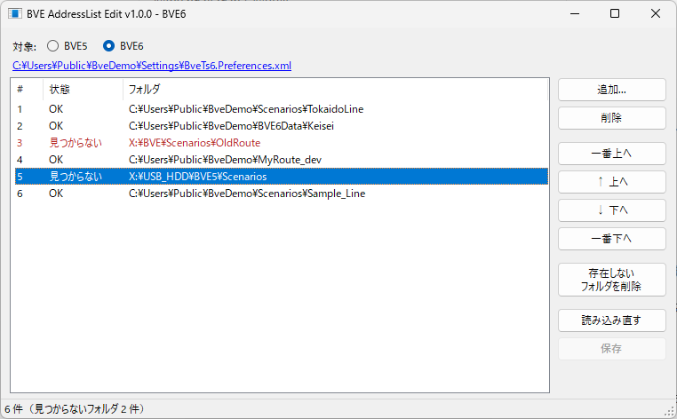

# BVE AddressList Edit

BVE Trainsim 5 / 6 のシナリオ選択画面に出る**フォルダの履歴を整理する**ツールです。
履歴の追加、並べ替え、PC に存在しないフォルダの一括削除ができます。



## ダウンロード

[Releases](../../releases/latest) から `BveAddressListEdit_vX.X.X.zip` をダウンロードし、好きな場所に展開してください。
`BveAddressListEdit.exe` をダブルクリックすると起動します。インストールは不要です。

- 動作環境: Windows 10 / 11（.NET Framework 4.8。BVE が動く PC ならそのまま動きます）
- 初回起動時に Windows SmartScreen の警告が出た場合は「詳細情報」→「実行」で起動できます。

## 使い方

1. **BVE を終了してから**このツールを起動します。
2. 画面上部の「対象」で BVE5 / BVE6 を選びます。
3. 履歴を整理します。
   - **追加**: 「追加...」でフォルダを選ぶ（複数選択可）と、一番上に追加されます。
     エクスプローラーからフォルダやシナリオファイルをリストにドラッグ＆ドロップしても追加できます（落とした位置に入ります）。
   - **並べ替え**: 「一番上へ / ↑ 上へ / ↓ 下へ / 一番下へ」、または行をドラッグして移動します。複数行まとめて動かせます。
   - **存在しないフォルダの削除**: 見つからないフォルダは赤字で表示されます。「存在しないフォルダを削除」でまとめて消せます（消す前に一覧を確認できます）。
   - **削除**: 選んだ行を消します（Delete キーでも可）。
4. 「**保存**」（Ctrl+S）を押すと BVE の設定ファイルに書き込まれます。

そのほか、行のダブルクリックでフォルダを開く、右クリックでパスをコピー、「読み込み直す」（F5）で保存前の変更を取り消す、ができます。

## 設定ファイルが見つからないとき

起動時に `ドキュメント\BveTs\Settings` に設定ファイルがないと、PC 内から探すか確認します。
画面上部の「設定ファイルを探す...」からも、いつでも探せます。

- まず全ユーザーのドキュメント・OneDrive など、よく使われる場所を調べ、その後すべてのドライブを検索します（ネットワークドライブは対象外）。
- `Preferences.xml` はほかのソフトでも使われる名前なので、中身が BVE の設定かどうかも確認します。
- 見つかったものから使うファイルを選びます。目的のファイルが出たら、検索の途中でも選べます。
- 「ファイルを指定...」で、場所を直接選ぶこともできます。
- 選んだ場所は `%APPDATA%\BveAddressListEdit\paths.txt` に記録し、次回からもその場所を使います。

## 安全のための動き

- 保存するとき、直前の設定ファイルを `.bak` として同じフォルダに残します。
- 書き換えるのは履歴の部分だけです。ほかの BVE の設定はそのまま残ります。
- BVE は終了時に設定を書き戻すため、BVE の起動中に保存しようとすると警告します。
- 外付けドライブやネットワークドライブが外れているだけのフォルダも「見つからない」と表示されます。一括削除の前に一覧を確認してください。

## 編集する設定ファイル

| 対象 | ファイル |
|---|---|
| BVE5 | `ドキュメント\BveTs\Settings\Preferences.xml` の `ScenarioForm/Address` |
| BVE6 | `ドキュメント\BveTs\Settings\BveTs6.Preferences.xml` の `ScenarioForm/Address` |

## 開発者向け

```
dotnet build -c Release
```

`bin\Release\net48\BveAddressListEdit.exe` が出力されます（.NET SDK 8 以降が必要）。
起動時の引数で設定フォルダを差し替えられるので、テストには設定ファイルのコピーを使えます。

```
BveAddressListEdit.exe "D:\test\Settings"
```

`v1.2.3` のようなタグを push すると、GitHub Actions がビルドして Releases に zip を公開します。

## ライセンス

[MIT License](LICENSE)

## 作者

かんたんのゆめ　NT/fiv

- X: [@BVE69345936](https://x.com/BVE69345936) ／ [@ntfiv](https://x.com/ntfiv)
- Web: https://kantanbay.jp/
- Blog: https://kty-bvememo.hatenablog.jp/

旧版（HSP 製「BVE5AddressListEdit α」）の紹介: https://kty-bvememo.hatenablog.jp/entry/BVE5ALE
